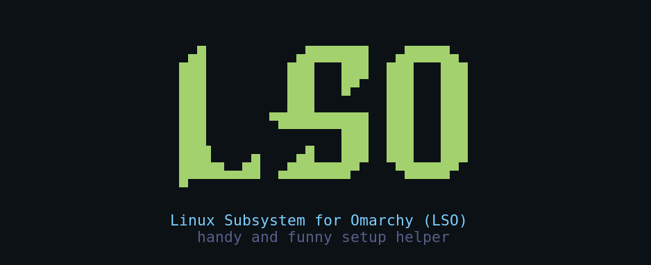
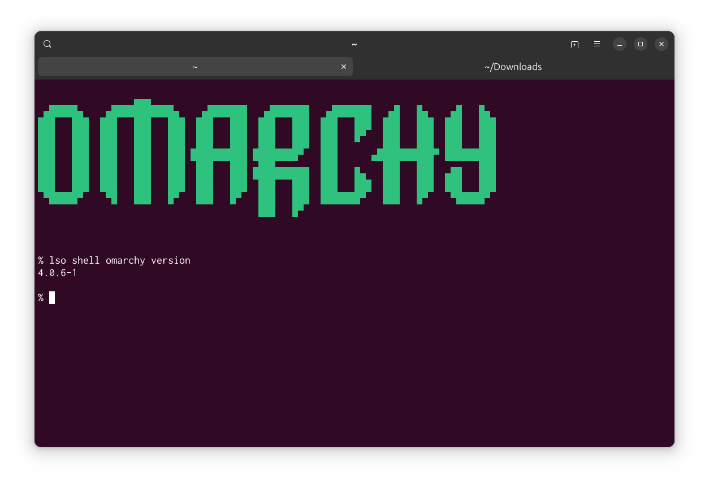

# LSO — Linux Subsystem for Omarchy

*handy and funny setup helper*

This is nothing like WSL and may feel like a `virsh` wrapper, but no one can stop us from naming it LSO :)



## Get started

You need the `lso` executable on your `PATH`, plus a Linux host with KVM, libvirt, UEFI firmware (OVMF) and `virt-viewer`. Not sure about your setup? Run `lso install --check` for a preflight.

Here is what you need to get started:

```sh
lso install                # set up a new Omarchy instance
lso desktop --fullscreen   # open the full Omarchy desktop
lso                        # or: lso shell <commands>
lso app <name>             # stream one app, picked from `lso app list`
```

```sh
$ lso shell omarchy version
4.0.6-1
```



`lso install` initializes the instance without upgrading the guest OS, and asks you for a username and password. `lso install` picks the ISO in this order: a local `--iso` file if it exists and is non-empty, otherwise it reuses `~/.lso/cache/omarchy-4.0.6.iso`, or downloads the official `https://iso.omarchy.org/omarchy-4.0.6.iso` there first (needs `curl`; roughly 6 GiB, not included in any local install timings). The download is only checked for being non-empty, not cryptographically verified. If a path you pass is missing or empty, LSO warns and falls back to the cache/download. To use your own ISO:

```sh
lso install --iso /path/to/omarchy.iso
```

Instance state lives under `~/.lso/<name>` (the default name is `default`).

## Apps vs. desktop

`lso app` streams a single window onto your host desktop using `waypipe`. It needs `waypipe` on the host *and* in the guest; LSO does not install it for you. `lso desktop` is the separate full-desktop route and doesn't need it.

## A few more

```sh
lso install --name work --resource low   # a smaller named instance
lso list                                  # see your instances
lso -n work                               # shell into one
lso status                                # state, IP, usage
lso stop                                  # power it off
lso env                                   # show resolved paths
```

## Support

Currently LSO is extensively tested on Ubuntu (24.04 host). Please feel free to open a PR to support more distros.

## License

[0BSD](LICENSE). Omarchy and any other upstream projects belong to their respective authors and are not covered by this license.
